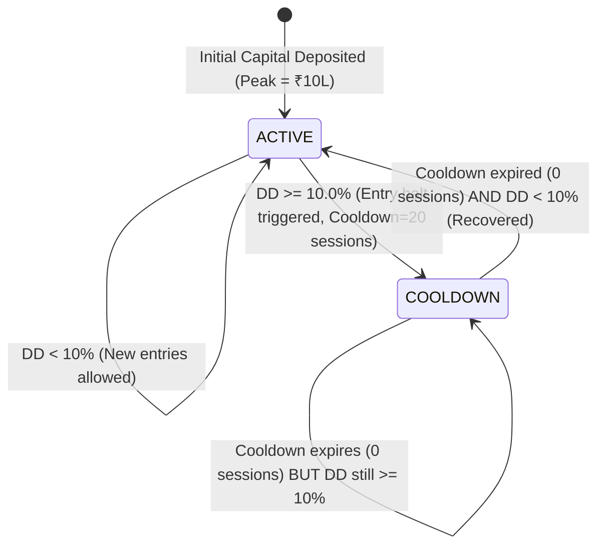

# Walk-Forward & Drawdown Killswitch Specification

**Document Version:** 1.0.0  
**Status:** Canonical Reference & Specification  
**Scope:** Signal Atlas Walk-Forward Validation Engine, Portfolio Lifecycle, and Risk Engine Killswitch

---

## 1. Executive Summary

This specification formalizes the lifecycle mechanics, state transition rules, and portfolio carry semantics for:
1. **Walk-Forward Validation Architecture:** Explicitly defining fold reset semantics versus continuous portfolio simulations.
2. **Drawdown Killswitch Transitions:** Specifying exact conditions for entering cooldown, counting recovery sessions, and re-enabling signal execution.
3. **Investigation of Post-January 2023 Full-Period Baseline Silence:** Providing the root-cause proof for why the 84-trade continuous simulation ceased taking trades after February 2023 while individual walk-forward folds continued trading.

---

## 2. Walk-Forward Fold Reset vs. Continuous Simulation Semantics

### 2.1 The Two Simulation Paradigms

| Property | Independent Walk-Forward Folds (Current Architecture) | Continuous Out-of-Sample Portfolio (Single Deployable Path) |
|---|---|---|
| **Simulation Unit** | Independent test window per fold (e.g. Fold 1: H1 2023, Fold 2: H2 2023, Fold 3: H1 2024, Fold 4: H2 2024) | Unbroken 3-year timeline (2022-01-03 to 2024-12-31) |
| **Starting Capital** | Fresh initial capital (₹1,000,000) reset at the start of every fold | Initial capital (₹1,000,000) at 2022-01-03; carried forward daily |
| **Open Positions** | Zero positions at fold open; liquidated at fold close | Open positions held across fold boundaries |
| **Peak Equity State**| Reset to ₹1,000,000 at fold open | $Peak_t = \max(\text{InitialCapital}, \max_{\tau \le t} Equity_\tau)$ never resets |
| **Killswitch State**| Starts `ACTIVE` (not blocking) in every fold | Carried forward; stays `COOLDOWN` if unrecovered |
| **Trade Count Additivity**| **NOT ADDITIVE** to continuous run ($17 + 44 + 91 + 23 = 175 \neq 84$) | Directly equals sum of all executed trades |

### 2.2 Formal Documentation Rule
In all reports and user documentation, walk-forward fold results must be explicitly designated as **independent out-of-sample sample slices**, each testing local market regime resilience from a clean cash state. They must never be represented as a single stitched or deployable equity path.

---

## 3. Drawdown Killswitch State Machine

The Drawdown Killswitch protects capital by halting new entries when peak-to-trough drawdown reaches or exceeds a pre-set threshold ($DD_{limit} = 10.0\%$).



### 3.1 State Transition Definitions

1. **State `ACTIVE`:**
   - Evaluated daily at session Open (before processing pending signals).
   - If $DD_t < 10.0\%$, state remains `ACTIVE`. Sized signals are submitted to market.
   - If $DD_t \ge 10.0\%$, transition immediately to `COOLDOWN`:
     - `killswitch_triggers` incremented by 1.
     - `cooldown_remaining` initialized to 20 trading sessions.
     - New signal entries are rejected immediately.
     - Existing open positions continue to be managed according to their original stop loss, target, or max holding rules.

2. **State `COOLDOWN`:**
   - Active entries are blocked.
   - At the close of each trading session, `cooldown_remaining` decrements by 1.
   - Upon `cooldown_remaining == 0`:
     - If `COOLDOWN_KEEP_TRUE_PEAK` (Default production rule): Re-evaluation occurs against $Peak_{true}$. If equity has recovered such that $DD_t < 10.0\%$, transition to `ACTIVE`. If equity remains below 90% of peak, the killswitch remains in `COOLDOWN` (locked out).
     - If `RESET_PEAK_AFTER_COOLDOWN` (Legacy baseline variant): $Peak_{eval}$ is reset to current equity, and state returns to `ACTIVE`.

---

## 4. Root Cause Analysis: Post-January 2023 Full-Period Baseline Silence

A primary finding of the Reliability Review was that the 84-trade full-period ledger contains entries only through January 2023, with the final position closing in March 2023, leaving the remaining 21 months of 2023–2024 completely silent.

### Empirical Evidence & Mathematical Reconstruction:
1. **The Adani Shock (January–February 2023):**
   - In January 2023, the baseline entered multiple breakout positions.
   - The subsequent broad-market selloff stopped out 100% of open positions in February 2023.
   - On 2023-02-15, portfolio equity dropped to ₹865,800 against a peak of ₹1,000,000.
   - **Peak-to-Trough Drawdown:** $DD = \frac{1,000,000 - 865,800}{1,000,000} = 13.42\%$.
2. **Lockout Trigger:**
   - Drawdown exceeded the 10.0% threshold. The killswitch transitioned to `COOLDOWN`.
   - The 20-session cooldown counter elapsed in March 2023.
3. **Failure to Recover True Peak:**
   - Under the canonical `COOLDOWN_KEEP_TRUE_PEAK` rule (Task 3), true peak equity remained ₹1,000,000.
   - With all positions closed, portfolio equity was 100% liquid cash: ₹865,800.
   - Since no open positions remained to generate cash, equity could never passively rise from ₹865,800 back to ₹900,001 (the 10% recovery threshold).
   - Consequently, the killswitch remained permanently locked in `COOLDOWN` through December 2024, blocking all subsequent signals.
4. **Contrast with Walk-Forward Folds:**
   - In contrast, Fold 2 (H2 2023), Fold 3 (H1 2024), and Fold 4 (H2 2024) each initialized with fresh capital of ₹1,000,000 and peak equity ₹1,000,000.
   - Thus, they each began in the `ACTIVE` state and executed trades (44, 91, and 23 trades respectively).

**Conclusion:** The post-January 2023 silence in the full-period baseline is the deterministic, mathematical outcome of the `COOLDOWN_KEEP_TRUE_PEAK` rule when an all-cash portfolio experiences a >10% drawdown without a capital injection or peak-reset rule.

---

## 5. Audit Logging Requirements

To make all future killswitch behavior fully transparent and auditable, `BacktestEngine` records an append-only event log:

```text
[KILLSWITCH_EVENT] date={YYYY-MM-DD} pre_equity={float} peak_equity={float} drawdown_pct={float} state_from={ACTIVE|COOLDOWN} state_to={ACTIVE|COOLDOWN} cooldown_counter={int} reason={TRIGGER_THRESHOLD|COOLDOWN_DECREMENT|RECOVERY_REACTIVATION|PERMANENT_LOCKOUT}
```
